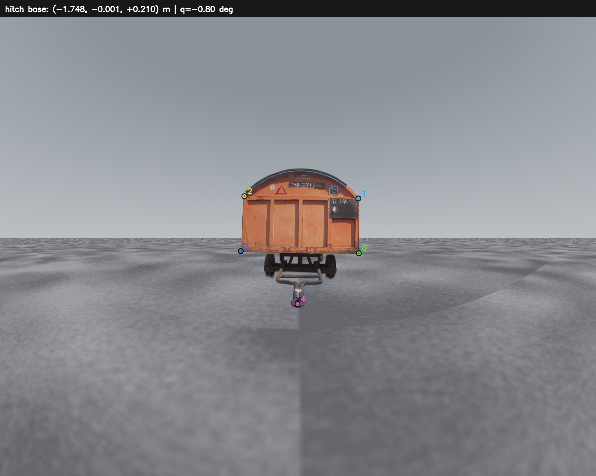

# Trailer Perception

**DINOv2 五关键点检测 → 鱼眼 PnP 初始化 → 铰链约束三维位姿估计。**

This repository packages a runnable trailer perception pipeline, its trained
M0 checkpoint, and the metric mesh/3D Gaussian scene. No ROS installation,
original experiment directory, server account, or training run is required.



## Quick start / 快速运行

Python 3.10–3.12; Linux is the tested platform. CPU inference is supported.
Run commands from the repository root:

```bash
git clone https://github.com/DX3906199/trailer-perception.git
cd trailer-perception
python3 -m venv .venv
source .venv/bin/activate
python -m pip install --upgrade pip
# CPU installation; CUDA users install a matched torch/torchvision build first.
python -m pip install torch torchvision --index-url https://download.pytorch.org/whl/cpu
python -m pip install -e '.[detector,test]'
python scripts/download_weights.py

# Image → five keypoints → articulated metric pose → JSON and overlay.
trailer-perception run --input examples/straight.png --device cpu
```

Read `outputs/run/prediction.json` and `outputs/run/overlay.jpg`.
For NVIDIA inference, install matching CUDA PyTorch packages and use
`--device cuda:0`. The full checkpoint contains the DINOv2 backbone; inference
does not download any additional model. Released weights are SHA-256 checked.

中文版：直接运行上面命令，得到箱体四个角点、挂孔中心，以及挂孔在
`base_link` 下的米制坐标。模型输入为 896，但输出坐标已还原到原始图像。

## Separate detection and PnP / 分步运行

```bash
trailer-perception detect --input examples/straight.png --output outputs/detection
trailer-perception pnp --points outputs/detection/prediction.json --output outputs/pose.json

# Geometry-only check, no PyTorch or model download needed.
trailer-perception pnp --points examples/straight_keypoints.json
trailer-perception geometry-demo

# Another bundled example: articulated Gaussian scene, q=10 degrees.
trailer-perception run --input examples/articulated_10deg.png --output outputs/articulated

# Your original-size video: per-frame JSONL and an annotated MP4.
trailer-perception video --input your_video.mp4 --device cuda:0
```

The geometry-only example recovers a hitch near `[-1.74524, 0, 0.21]` metres.
These example pixels are generated geometric labels; this command tests the
solver independently of network error. `run` uses predicted pixels instead.

## Five points and geometric model

| Index | Name | Definition |
|---|---|---|
| 0 | `body_front_right_lower` | Front rectangle, asset-right lower corner |
| 1 | `body_front_right_upper_rectangle` | Asset-right upper rectangle corner |
| 2 | `body_front_left_upper_rectangle` | Asset-left upper rectangle corner |
| 3 | `body_front_left_lower` | Asset-left lower corner |
| 4 | `hitch_center` | Hitch-ring aperture centre |

Left/right refer to the trailer asset, not an arbitrary screen viewpoint.
The upper two points lie on the rectangular front face; they exclude the arch.

Edit [`configs/geometry.yaml`](configs/geometry.yaml) to set original image
dimensions, intrinsics, four equidistant coefficients, camera mounting,
metric landmarks and hinge geometry. Defaults: 1920×1536, camera offset
`[-0.6,0,0.7] m`, rear-facing and horizontal (`pitch_down_deg: 0`).

This is a **four-state constrained estimator**:
`[body_x_base, body_y_base, body_yaw_base, articulation_angle]`.
It uses known metric shape, ground/height, and hinge axis. Box height, roll and
pitch are fixed. It does not estimate two unrelated arbitrary 6-DoF bodies.

The solver undistorts the four box corners, constructs SQPnP/known-height
initializations, searches the hinge angle, and jointly minimizes five-point
fisheye reprojection error with Huber loss. No simulator state initializes it.
Returned positions use metres, angles radians, and covariance the same state
order. `base_link`: X forward, Y left, Z up. A rear target normally has **negative X**.

On invalid/ambiguous geometry it returns `valid: false` and null state/target.
M0 heatmap responses are **not calibrated confidence probabilities**: the
network has no separate object-presence or occlusion classifier. Correct
camera calibration and visible, corresponding points are needed for meaningful
3D results. Real-image training annotation coordinates are not surveyed 3D truth.

## Simulation scene / 仿真场景

```bash
python -m pip install -e '.[simulation]'

# Interactive MuJoCo scene (desktop display required).
python scripts/render_scene.py --mode viewer

# Calibrated mesh camera image, no CUDA required (Linux EGL).
MUJOCO_GL=egl python scripts/render_scene.py --mode mesh --output outputs/mesh.png

# Optional CUDA gsplat rendering, closest to detector training appearance.
# Requires CUDA PyTorch, CUDA toolkit (nvcc), ninja and a C++ compiler.
python -m pip install -e '.[gaussian]'
python scripts/render_scene.py --mode gaussian --x -2.0 --angle 15 --output outputs/gaussian.png
trailer-perception run --input outputs/gaussian.png --config outputs/gaussian.yaml --device cuda:0
```

MuJoCo loads the static OBJ mesh. The separate gsplat backend renders the
split Gaussian body and movable drawbar/front-axle/wheel assembly, using the
same camera calibration. A six-face render covers the full fisheye image.
`--x`, `--y`, `--yaw` specify **ego world pose** (metres/degrees), not relative
body pose; `--angle` sets joint degrees. Mesh mode only supports zero articulation.
`--width` changes resolution and produces an appropriately scaled `.yaml`;
always pass that sidecar to inference. No ROS, physics contact or driving
controller is required for these perception demonstrations.

## Model / 当前发布模型

M0 uses frozen DINOv2 ViT-S/14 and a trained five-channel heatmap decoder at
896 input. It was trained on 1,000 multi-angle synthetic images and then
fine-tuned for 20 epochs with those images plus 100 reviewed real frames.
The published checkpoint is the final epoch, without optimizer/private paths.
See [`docs/MODEL_CARD.md`](docs/MODEL_CARD.md) and
[`weights/manifest.json`](weights/manifest.json).

## Layout and verification

```text
src/trailer_perception/  detector, geometry, pose, scene, CLI
configs/                camera, landmarks, hinge, MuJoCo XML
assets/scene/           full/split Gaussian PLY, OBJ and ground texture
weights/manifest.json   model URL, size and SHA-256
examples/               synthetic image and five-point geometry fixture
scripts/                weight download, scene demo and release tools
tests/                  projection, pose, image transforms and scene tests
```

```bash
python -m pytest -q
```

Unit tests do not require a GPU or downloading weights; detector tests require
the detector extra. See [`docs/VALIDATION.md`](docs/VALIDATION.md) for release
checks and [`THIRD_PARTY_NOTICES.md`](THIRD_PARTY_NOTICES.md) for dependencies.
Historical datasets, raw rosbags, credentials, environment directories, training
logs and previous experiments are not part of this runnable export.
